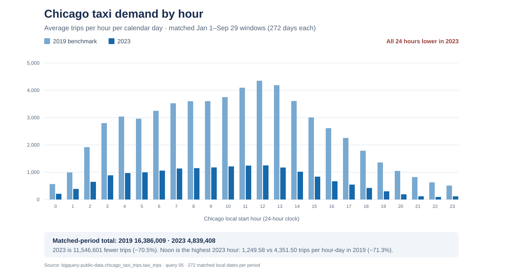

# Findings

*One manager-focused gap: fewer recorded taxi trips in the matched 2023 period than in 2019, expressed as an estimated recorded-fare equivalent.*

## The gap

One source row represents one recorded taxi trip. The comparison uses 272 Chicago-local dates, January 1 through September 29, in each year. The 2019 benchmark window contains 16,386,009 trips; the same 2023 window contains 4,839,408 trips. That is **11,546,601 fewer trips**, a **70.5% decline** from the 2019 benchmark.

To express the scale in dollars, apply the observed 2023 mean recorded fare to the trip-count difference:

| Calculation | Result |
|---|---:|
| 2023 mean recorded fare per fare-bearing trip: $142,690,533.04 / 6,415,469 | Approximately $22.24163706 per trip |
| Matched-period trip difference: 16,386,009 − 4,839,408 | 11,546,601 fewer trips |
| Estimated fare equivalent: 11,546,601 × ($142,690,533.04 / 6,415,469) | **$256,815,308.67** |

The trip counts come from [query 05](sql/05_matched_period_benchmark_2019_2023.sql). The 2023 fare total comes from [query 04](sql/04_fare_by_day_hour_2023.sql), and the 6,415,469 fare-bearing trip count is 6,427,460 scoped rows minus 11,991 null fares from [query 01](sql/01_data_quality_2023.sql). The $256.8 million is an **estimated fare equivalent**, not an observed 2019-versus-2023 fare shortfall, profit, preventable loss, or causal impact. It assumes each trip in the count difference would have earned the average recorded fare observed across all of 2023.

COVID-19 is a plausible contributing factor to the lower 2023 volume. A Chicago taxi-trip study observed a sharp decline in mobility during the pandemic's onset and a recovery that remained below pre-pandemic levels. Our endpoint comparison does not isolate the pandemic's contribution or distinguish it from other changes; treat COVID-19 as context, not a proven cause. ([Chicago taxi mobility study](https://pmc.ncbi.nlm.nih.gov/articles/PMC9070917/))

## The benchmark

2019 is the earlier-period benchmark because the table has no 2020 or 2021 records, while 2022 begins partway through the year. The 2019 data extends from January into early October, so this comparison uses the same complete Jan 1–Sep 29 local-date window in 2019 and 2023. Equal 272-day windows make the trip-count comparison more meaningful than comparing the partial 2019 total with the full 2023 total. The benchmark shows the scale of the recorded decline; it does not explain why it occurred.

## Value

For a manager, the estimated **$256,815,308.67 fare equivalent** communicates the order of magnitude associated with the lower trip count. The calculation is 11,546,601 × ($142,690,533.04 / 6,415,469). It is a comparison estimate under that assumption, not a realized revenue loss or a staffing savings forecast. The source `fare` field excludes tips, tolls, and extras.

## Chart

The chart shows the project’s 2019–2023 gap on the left and the published COVID-era context as a separate bar pair on the right.

**COVID-19 context below the chart:** A Chicago taxi mobility study covering January–October 2020 reports an average of 32,917 trips per day before the pandemic period and approximately 1,553 during the crisis, a study-reported decrease of about 95.3%. These bars use the study's own period definitions and source; they are contextual evidence, not additional observations from this project's BigQuery comparison. The study describes a sharp decline during the pandemic's onset and partial recovery that remained below pre-pandemic levels. [Read the Chicago taxi mobility study](https://pmc.ncbi.nlm.nih.gov/articles/PMC9070917/).

## Limits

- The 2019 and 2023 counts are observed BigQuery results; the dollar amount is estimated using the 2023 full-year mean fare per fare-bearing trip.
- The 85 rows with end timestamps earlier than start timestamps remain included in the source population. No rows were excluded from the trip comparison.
- The table does not show why trip counts changed; this is not a causal analysis.
- `fare` is recorded fare, not net company revenue, profit, driver income, or avoidable loss.
- Final confirmation of the 2023 Chicago-local date boundaries remains part of the project review.
